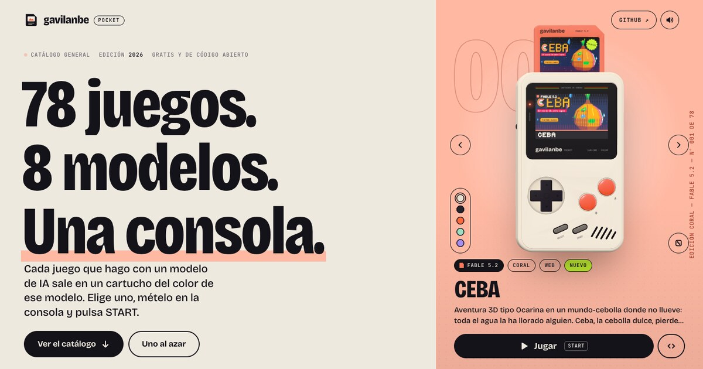

<div align="center">

# 🎮 gavilanbe 64

**Una habitación de los 90 con todos mis juegos en cartucho, cada uno del color del modelo que lo hizo. Coge uno de la pared, mételo en la consola y pulsa START.**

[](https://gavilanbe.github.io/)

</div>



## Cómo funciona

- **Pantalla de título.** El emblema se monta, el logo cae letra a letra y espera un START. Al pulsarlo,
  la cámara sale de dentro de la tele y descubre la habitación.
- **La habitación** es una maqueta en corte de un dormitorio al atardecer, modelada por código con
  pocos polígonos y color por vértice (three.js): la **gavilanbe 64** con su mando de tres cuernos
  sobre la alfombra, la tele de tubo con Gavi (el gavilán de peluche) encima, la cama bajo la ventana
  y una pared entera con la colección. El reloj marca la hora de verdad.
- **La colección.** Una columna de baldas por modelo, con su placa y su color. Cada cartucho lleva la
  captura del juego, su título y el sello del modelo; los de terminal, la marca `>_`. Al pasar el
  ratón se asoman y dicen su nombre.
- **Elegir.** Al tocar un cartucho sale volando, gira y entra en la consola; el que estaba dentro
  vuelve a su balda. La tele arranca con el logo y enseña la carátula, y su resplandor toma el color
  del modelo.
- **START** (el botón, `↵` o tocar la pantalla de la tele) mete la cámara en la tele y abre el juego.
  En los de terminal copia el `git clone`.
- **Tres vistas** (Habitación, Colección, Consola; teclas `1` `2` `3`), flechas para cambiar de
  cartucho o moverse por la pared, y `B` para volver.
- **Buscar** (`/`): un panel con buscador, filtro por modelo y la lista completa. Lo que no coincide
  se hunde en la pared. Es también la vía rápida en el móvil y lo que queda si no hay WebGL.
- **Enlace directo**: `https://gavilanbe.github.io/#<slug>` abre con ese cartucho puesto.

Las versiones anteriores siguen en las etiquetas git (`pocket-v8` y anteriores); la primera, en
[`/classic/`](https://gavilanbe.github.io/classic/).

## Desarrollo

El código vive en [`g64/`](g64/): `kit.js` (herramientas de modelado), `cart.js`, `console.js`,
`tv.js`, `room.js` (las piezas), `scene.js` (luz, cámara, vuelo) y `main.js` (interfaz).
`g64/index.html` es la página de desarrollo, que carga los módulos sueltos; la de la raíz y
`lib/g64/` **se generan** con `npm run bundle`.

- Para trabajar: `python3 -m http.server 4391` y abrir `http://127.0.0.1:4391/g64/`.
  `g64/lab.html?a=cart` (o `console`, `tv`) enseña una pieza suelta.
- `npm run bundle`: empaqueta `g64/` con three.js en `lib/g64/` y regenera `index.html`.
  **Hay que ejecutarlo antes de publicar** cualquier cambio en `g64/` o `editions.js`.
- `npm ci && npm test`: regresiones sin navegador (datos, miniaturas, ediciones, ids, que el paquete
  esté al día y que la colección quepa en la pared).
- `npm run smoke`: prueba en Chromium (Playwright), escritorio y móvil, sobre la página empaquetada.
  Con `-- --shots` deja capturas en `dist/smoke/`. La primera vez: `npx playwright install chromium`.
- `npm run thumbs`: miniaturas pequeñas (`thumbs/s/*.webp`, 320×200); necesita ImageMagick.

## Añadir un juego

1. Añade su entrada en `data.js` (orden alfabético por `name`):

```js
{
  "name": "mi-juego",                                   // slug del repo
  "title": "🎮 MI JUEGO · Un subtítulo",                // emoji, título y, si quieres, subtítulo tras « · »
  "tagline": "Una frase con gancho.",
  "type": "web",                                        // "web" | "terminal"
  "play": "https://gavilanbe.github.io/mi-juego/",      // vacío si es terminal
  "repo": "https://github.com/gavilanbe/mi-juego",
  "thumb": "thumbs/mi-juego.jpg",                       // 640×400 (16:10)
  "wip": false,                                          // cinta «WIP» en la etiqueta
  "new": true,                                           // pegatina «NUEVO»; sale puesto en la consola
  "kind": "juego",
  "model": "fable-5.2",                                  // una clave de editions.js
  "also": {"model": "opus-5.5", "note": "con"}           // opcional: un segundo modelo
}
```

2. Deja su captura en `thumbs/mi-juego.jpg` (640×400) y ejecuta `npm run thumbs`.
3. Quita el `"new": true` de la hornada anterior.
4. `npm test`, commit y push a `main`. Los datos se leen al cargar: **no hace falta reempaquetar**.

**Un modelo nuevo** es una línea en `EDITIONS` de [`editions.js`](editions.js) (nombre, color del
plástico, color de fondo, tinta y material) y después `npm run bundle`.

**La pared está llena**: son 16 columnas de seis cartuchos y la colección ocupa las 16. Cuando un
modelo necesite una columna más, `npm test` avisará y habrá que ampliar la estantería en
`g64/room.js` (más filas o cartuchos algo más pequeños).

El cartucho **TRAZO** es de edición `astra` (plástico fosforito) y se publica en [gavilanbe.github.io/trazo/](https://gavilanbe.github.io/trazo/). Su código vive en [gavilanbe/trazo](https://github.com/gavilanbe/trazo).

El cartucho **NAGU & GAVI · El corazón de la selva** también es `astra`: [jugar](https://gavilanbe.github.io/nagu-gavi/) · [código](https://github.com/gavilanbe/nagu-gavi). Incluye intro con retratos parlantes, cinco semillas de sol y 36 plumas.

El cartucho **INVOCA** (ajedrez de bestias isométrico en micro pixel art) es de edición `fable-5.1` (hielo): [jugar](https://gavilanbe.github.io/invoca/) · [código](https://github.com/gavilanbe/invoca).

El cartucho **CEBA** (aventura 3D tipo Ocarina de una cebolla dulce, con arte estilo picoCAD) estrena la edición `fable-5.2` (coral): [jugar](https://gavilanbe.github.io/ceba/) · [código](https://github.com/gavilanbe/ceba).
